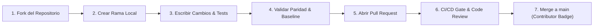

# Guía de Contribución a Military-Grade Cyberdefense (DEFCON-1)

¡Gracias por tu interés en contribuir a este proyecto de ciberdefensa de código abierto! Toda contribución que mejore la postura de seguridad, corrija defectos o amplíe capacidades defensivas es bienvenida.

Al ser un proyecto enfocado en **ciberdefensa y seguridad de misión crítica**, aplicamos una política estricta de **Revisión, Verificación y Tolerancia Cero al Código Malicioso** para proteger la integridad de todos los usuarios de la comunidad.

---

## 🎖️ Reconocimiento a Colaboradores

GitHub registra y atribuye automáticamente tu autoría en la pestaña **Contributors** del repositorio en cuanto tu Pull Request sea revisado, aprobado y fusionado (*merged*) en la rama `main`. Tu nombre, foto de perfil y enlaces a tus commits quedarán plasmados de forma permanente.

---

## 🔒 Proceso de Contribución Paso a Paso

Para evitar problemas de seguridad, **nadie tiene permisos directos de escritura en la rama `main`**. Todas las contribuciones siguen el flujo estándar de bifurcación (*Fork*):



### 1. Haz un Fork del Repositorio
Haz clic en el botón **Fork** en la esquina superior derecha del repositorio en GitHub para crear una copia en tu cuenta personal.

### 2. Clona tu Fork localmente
```bash
git clone https://github.com/TU-USUARIO/military-cyberdefense-skill.git
cd military-cyberdefense-skill
```

### 3. Crea una Rama de Trabajo Específica
Utiliza nombres descriptivos:
```bash
# Para corregir un error
git checkout -b fix/nombre-del-error

# Para una mejora o nueva regla
git checkout -b feat/nueva-capacidad
```

### 4. Aplica tus Cambios y Valida Localmente
Antes de hacer commit, debes certificar que tus cambios cumplen con los estándares del proyecto:

1. **Verificar Paridad con el SSOT:**
   ```bash
   python scripts/sync-and-validate.py
   ```
   *(Debe mostrar estado `DEFCON-5 (100% SYNCHRONIZED)`)*.

2. **Ejecutar el Escáner Base contra tus Cambios:**
   ```bash
   python scripts/check-security-baseline.py --diff
   ```
   *(Debe mostrar 0 defectos críticos/altos)*.

3. **Verificar que los Scripts Compilen:**
   ```bash
   python -m py_compile scripts/*.py
   ```

### 5. Reglas de Oro de Seguridad (Lo que NO será Aceptado)
Cualquier Pull Request que contenga lo siguiente será **rechazado y cerrado de inmediato**:
- ❌ **Código ofuscado:** Uso de `eval()`, `exec()`, cadenas en Base64 no documentadas o caracteres Unicode invisibles (Zero-Width spaces).
- ❌ **Llamadas de red o telemetría no documentadas:** Ningún script debe enviar datos, métricas ni telemetría a servidores de terceros desconocidos.
- ❌ **Secretos o credenciales:** Nunca incluyas API keys, contraseñas, tokens de prueba reales o datos privados.
- ❌ **Dependencias de terceros innecesarias o no verificadas:** Priorizamos la biblioteca estándar de Python y scripts nativos para evitar vulnerabilidades en la cadena de suministro (*typosquatting*).
- ❌ **Debilitamiento de reglas:** Modificaciones a `rules/security-rules.json` que reduzcan la rigurosidad de las comprobaciones sin justificación técnica y consenso.

### 6. Firma de Commits (Recomendado)
Te animamos a firmar criptográficamente tus commits con GPG o SSH (`git commit -S -m "..."`) para que aparezca la insignia verde **Verified** en GitHub.

### 7. Abre el Pull Request
1. Haz push de tu rama a tu fork:
   ```bash
   git push origin fix/nombre-del-error
   ```
2. Ve a GitHub y haz clic en **Contribute > Open pull request**.
3. Completa la plantilla del Pull Request describiendo detalladamente:
   - ¿Qué problema soluciona?
   - ¿Qué archivos fueron modificados?
   - ¿Cómo probaste la solución?

---

## 🛡️ ¿Qué Ocurre Después de Abrir tu PR?

1. **Pipeline Automatizado (DEFCON-1 Defense Gate):** GitHub Actions ejecutará automáticamente los escaneos de código, paridad, dependencias con Google OSV y análisis de secretos con TruffleHog.
2. **Revisión Humana:** El mantenedor del proyecto revisará el diff línea por línea. Si se requieren ajustes, te dejará comentarios en la discusión del PR.
3. **Fusión (Merge):** Una vez aprobado y con todos los checks en verde, se fusionará a `main` y tu contribución quedará acreditada oficialmente.
