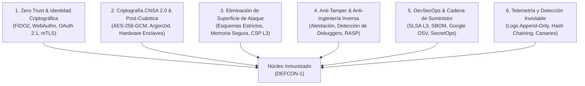

# 🛡️ Military-Grade Cyberdefense Skill (DEFCON-1)

> **Suite Integral de Ciberdefensa Militar, Blindaje de Aplicaciones y DevSecOps de Alta Seguridad para Google Antigravity y Entornos de Misión Crítica.**


---

## 📌 Tabla de Contenidos

1. [Descripción General y Filosofía](#-descripción-general-y-filosofía)
2. [Los 6 Pilares de la Ciberdefensa Militar](#-los-6-pilares-de-la-ciberdefensa-militar)
3. [Estructura del Proyecto y Catálogo de Componentes](#-estructura-del-proyecto-y-catálogo-de-componentes)
4. [Capacidades y Doctrinas de Seguridad Integradas](#-capacidades-y-doctrinas-de-seguridad-integradas)
5. [Guía Paso a Paso: Cómo Utilizar el Proyecto](#-guía-paso-a-paso-cómo-utilizar-el-proyecto)
   - [Paso 0: Requisitos Previos](#paso-0-requisitos-previos)
   - [Paso 1: Instalación y Activación](#paso-1-instalación-y-activación)
   - [Paso 2: Validación de Paridad y Reglas (SSOT)](#paso-2-validación-de-paridad-y-reglas-ssot)
   - [Paso 3: Escaneo Estático de Seguridad de Código Base](#paso-3-escaneo-estático-de-seguridad-de-código-base)
   - [Paso 4: Auditoría de Dependencias y Cadena de Suministro (Google OSV)](#paso-4-auditoría-de-dependencias-y-cadena-de-suministro-google-osv)
   - [Paso 5: Monitoreo Criptográfico de Integridad de Archivos (FIM / Wazuh)](#paso-5-monitoreo-criptográfico-de-integridad-de-archivos-fim--wazuh)
   - [Paso 6: Auditoría Perimetral de Endpoints y EASM en Vivo](#paso-6-auditoría-perimetral-de-endpoints-y-easm-en-vivo)
   - [Paso 7: Protocolo de Parcheo Quirúrgico y Re-Verificación](#paso-7-protocolo-de-parcheo-quirúrgico-y-re-verificación)
   - [Paso 8: Despliegue de Plantillas de Configuración Blindadas](#paso-8-despliegue-de-plantillas-de-configuración-blindadas)
6. [Referencias Técnicas a Profundidad](#-referencias-técnicas-a-profundidad)
7. [Integración en Pipelines CI/CD](#-integración-en-pipelines-cicd)
8. [Aviso Legal y Descargo de Responsabilidad](#-aviso-legal-y-descargo-de-responsabilidad)

---

## 🎯 Descripción General y Filosofía

La **Military-Grade Cyberdefense Skill (DEFCON-1)** es un estándar de ingeniería defensiva e inmunización de software diseñado para operar de forma nativa dentro del asistente autónomo **Google Antigravity**, o bien como una **suite de herramientas CLI y DevSecOps autónoma** para desarrolladores, auditores y equipos de ciberdefensa.

Su objetivo primordial es **neutralizar amenazas persistentes avanzadas (APT), prevenir intrusiones no autorizadas, erradicar la superficie de ataque y garantizar la resiliencia criptográfica** en cualquier plataforma tecnológica:
- **Aplicaciones Web y APIs Backend** (Node.js/TypeScript, Python, Go, Rust, Java, C#, PHP).
- **Aplicaciones Móviles** (Android Kotlin/Java con StrongBox/Keystore, iOS Swift con Secure Enclave).
- **Entornos Desktop y Nativos** (Windows, Linux, macOS).
- **Infraestructura Cloud, Contenedores y Orquestación** (Docker rootless, Kubernetes, AWS, Azure, GCP).
- **Agentes Inteligentes, LLMs y Servidores MCP** (Detección de Prompt Injection, esteganografía Unicode y sandboxing).

> **Axioma Fundamental:**  
> *"Assume Breach. Verify Explicitly. Enforce Zero Trust at Every Interface. Minimize Blast Radius."*  
> *(Asume la brecha. Verifica explícitamente. Aplica Zero Trust en cada interfaz. Minimiza el radio de impacto).*

---

## 🛡️ Los 6 Pilares de la Ciberdefensa Militar

El marco de defensa se sustenta en 6 pilares de ingeniería inquebrantables:



1. **Zero Trust & Verificación Continua:** Desconfianza absoluta del perímetro de red y del estado del cliente. Autorización estricta por petición basada en identidad criptográfica y mínimo privilegio.
2. **Criptografía CNSA 2.0:** Prohibición absoluta de algoritmos obsoletos (MD5, SHA1, DES, 3DES, RC4, RSA < 3072, modos ECB/CBC). Cifrado autenticado obligatorio (AES-256-GCM, ChaCha20-Poly1305) y hashing de contraseñas resistente a memoria (Argon2id).
3. **Blindaje de Plataformas:** Configuración ultra-restrictiva de cabeceras HTTP (CSP Level 3 estricto con nonces, HSTS Preload), mitigación SSRF, prevención de Path Traversal y sandboxing de procesos.
4. **Resiliencia Anti-Manipulación (RASP):** Detección activa de debuggers (PEB, Hardware Breakpoints DR0-DR3), entornos con privilegios de Root/Jailbreak e instrumentación dinámica con Frida.
5. **Seguridad en la Cadena de Suministro:** Compilaciones herméticas, dependencias fijadas con verificación criptográfica SHA, escaneo continuo contra vulnerabilidades conocidas con Google OSV.dev y SecretOps en memoria RAM.
6. **Auditoría e Integridad Inviolable:** Monitoreo criptográfico de integridad de archivos (FIM con HMAC-SHA384), hash-chaining en logs para evitar manipulación forense y señuelos honeypot para bloqueo temprano.

---

## 📁 Estructura del Proyecto y Catálogo de Componentes

```text
military-cyberdefense-skill/
├── .gitignore                               # Exclusiones de Git (artefactos temporales, cachés, reportes)
├── SKILL.md                                 # Manifiesto formal de la Skill para Google Antigravity
├── README.md                                # Documentación completa, guía operativa y referencias
│
├── rules/                                   # FUENTE ÚNICA DE VERDAD (SSOT)
│   └── security-rules.json                  # Reglas canónicas (28 checks), cabeceras y parámetros
│
├── scripts/                                 # HERRAMIENTAS DE AUDITORÍA Y AUTOMATIZACIÓN
│   ├── sync-and-validate.py                 # Guardián de sincronización y paridad (Python)
│   ├── sync-and-validate.ps1                # Guardián de sincronización y paridad (PowerShell)
│   ├── check-security-baseline.py           # Escáner estático de código base con SARIF y GitDiff (Python)
│   ├── check-security-baseline.ps1          # Escáner estático de código base con SARIF y GitDiff (PowerShell)
│   ├── check-dependencies-osv.py           # Auditor de dependencias y cadena de suministro (Google OSV API)
│   ├── check-file-integrity.py             # Monitor FIM de integridad de archivos con HMAC-SHA384 (Wazuh)
│   ├── check-live-endpoint.py              # Auditor perimetral y EASM de URLs en vivo (RFC 9116 / Headers)
│   ├── patch-and-reverify.py               # Arnés de parcheo quirúrgico con re-test y auto-rollback (Python)
│   └── patch-and-reverify.ps1              # Arnés de parcheo quirúrgico con re-test y auto-rollback (PowerShell)
│
├── references/                              # MANUALES TÉCNICOS Y DOCTRINAS DEFENSIVAS
│   ├── AI-AND-LLM-DEFENSE.md                # Seguridad en IA, prompts, esteganografía y servidores MCP
│   ├── ANTI-TAMPER-AND-RESILIENCE.md        # RASP: Anti-x64dbg, Anti-Frida, Root, Jailbreak y Hooks
│   ├── CRYPTOGRAPHY-STANDARDS.md            # Criptografía CNSA 2.0, AES-256-GCM y limpieza anti-DSE en RAM
│   ├── DEVSECOPS-AND-SUPPLY-CHAIN.md        # SecretOps (Infisical), SLSA L3, SBOM y Google OSV.dev
│   ├── LOGGING-AND-TELEMETRY.md             # Logs a prueba de manipulación (Hash Chaining) y Honeypots
│   ├── OPERATOR-AND-WORKSTATION-HARDENING.md# Blindaje de la estación de trabajo del operador (FIDO2, BitLocker)
│   ├── OWASP-ASVS-L3-CHECKLIST.md           # Lista de verificación formal OWASP ASVS Nivel 3
│   ├── PATCH-AND-REVERIFY.md                # Protocolo de Parcheo Quirúrgico, Blast Radius y Proof-by-Exploitation
│   ├── PLATFORM-HARDENING.md                # Blindaje Web (CSP L3), Mobile, APIs, Docker e IaC
│   └── ZERO-TRUST-AND-AUTH.md               # Zero Trust, WebAuthn, OAuth 2.1 y JWT anti-algoritmo none
│
└── templates/                               # PLANTILLAS INDUSTRIALES LISTAS PARA PRODUCCIÓN
    ├── .dockerignore                        # Exclusión estricta de secretos y artefactos en builds de Docker
    ├── .env.example                         # Plantilla estandarizada de variables sin credenciales reales
    ├── .gitleaks.toml                       # Reglas militares de Gitleaks con allowlists de entropía
    ├── android-network-security-config.xml  # Configuración Android con bloqueo HTTP y Certificate Pinning
    ├── cloudflare-waf-rules.json            # Reglas WAF y Rate Limiting para Cloudflare (JSON)
    ├── cloudflare-waf.tf                    # Configuración declarativa en Terraform de Cloudflare WAF
    ├── docker-compose.hardened.yml          # Compose con read_only, cap_drop: ALL y loopback 127.0.0.1
    ├── Dockerfile.hardened                  # Dockerfile militar rootless y multi-stage (100% Trivy)
    ├── github-defense-gate.yml              # Pipeline CI/CD: Código + Google OSV + Aqua Trivy + TruffleHog
    ├── k8s-network-policy.yaml              # Políticas K8s Default-Deny y microsegmentación de red
    ├── nginx.hardened.conf                  # Configuración Nginx completa de alta seguridad y anti-tokens
    ├── pre-commit-hook.sh                   # Git Hook local que bloquea commits con secretos o fallos
    ├── security-headers.json                # Especificación canónica de cabeceras HTTP de seguridad
    ├── security-poc-test.template.ts        # Arnés TypeScript de test Proof-by-Exploitation para regresiones
    ├── SECURITY.md                          # Política estándar de divulgación coordinada de vulnerabilidades
    └── security.txt                         # Archivo estándar RFC 9116 para /.well-known/security.txt
```

---

## ⚡ Capacidades y Doctrinas de Seguridad Integradas

| Doctrina / Herramienta | Implementación en este Proyecto | Beneficio Operativo |
| :--- | :--- | :--- |
| **Fuente Única de Verdad (SSOT)** | `rules/security-rules.json` | 28 reglas de escaneo, cabeceras y parámetros centralizados. Cero desincronización entre herramientas. |
| **Guardián de Paridad** | `scripts/sync-and-validate.py` / `.ps1` | Verifica en CI/CD que plantillas, scripts y reglas compartan paridad al 100%. Auto-sincronización con `--sync`. |
| **Google OSV.dev** | `scripts/check-dependencies-osv.py` | Consulta la base de datos de vulnerabilidades en tiempo real de Google (npm, PyPI, Cargo, Go, Maven). |
| **SecretOps (Infisical)** | `DEVSECOPS-AND-SUPPLY-CHAIN.md` | Eliminación de archivos `.env` en disco. Inyección de secretos directamente en RAM contra *infostealers*. |
| **Gitleaks + TruffleHog** | `.gitleaks.toml` / `github-defense-gate.yml` | Filtro preventivo en pre-commit local y verificación activa en vivo en CI/CD contra endpoints de proveedores. |
| **FIM Criptográfico (Wazuh)** | `scripts/check-file-integrity.py` | Monitoreo de integridad con HMAC-SHA384 para detectar webshells o binarios modificados. Exporta SARIF. |
| **EASM & Live Audit (SpiderFoot)** | `scripts/check-live-endpoint.py` | Sondas automáticas a URLs en vivo: detecta fugas de `/.git`, `/.env`, cabeceras faltantes y DNS DMARC. |
| **Parcheo Quirúrgico (KeygraphHQ)** | `scripts/patch-and-reverify.py` | Aplica correcciones mínimas efectivas, evalúa Blast Radius, ejecuta tests y revierte cambios si hay regresión. |
| **Auditoría de Agentes (NVIDIA)** | `references/AI-AND-LLM-DEFENSE.md` | Detección de caracteres Unicode invisibles (Zero-Width) y defensas contra manipulación de prompts y herramientas MCP. |
| **Hardening de Operador (Alicia Sykes)** | `OPERATOR-AND-WORKSTATION-HARDENING.md` | Protocolos de blindaje de estaciones de desarrollo, YubiKey FIDO2, Git commit signing y prevención de *juice jacking*. |

---

## 🚀 Guía Paso a Paso: Cómo Utilizar el Proyecto

### Paso 0: Requisitos Previos

Para ejecutar la suite de auditoría y hardening, asegúrate de contar con:
- **Python 3.8 o superior** instalado en el sistema (no requiere librerías externas de terceros para los escaneos base; utiliza la biblioteca estándar `urllib`, `hashlib`, `json`, `re`, `argparse`).
- **PowerShell 5.1 o PowerShell Core 7+** (si se opera en entornos Windows o multiplataforma con scripts `.ps1`).
- **Git** instalado y configurado en el sistema.

---

### Paso 1: Instalación y Activación

Tienes 3 alternativas según tu flujo de trabajo:

#### Alternativa A: Instalación Global en Google Antigravity
Para que esta skill esté disponible automáticamente en **todos** los proyectos que abras con Antigravity:
1. Copia la carpeta completa `military-cyberdefense-skill` al directorio de skills de configuración de Antigravity:
   ```powershell
   Copy-Item -Recurse -Path "c:\Users\MyPC\Documents\military-cyberdefense-skill" -Destination "$HOME\.gemini\config\skills\military-cyberdefense"
   ```
2. Al reiniciar Antigravity o abrir una nueva conversación, la skill será indexada y estará disponible para cualquier auditoría o instrucción.

#### Alternativa B: Instalación Local en un Proyecto Específico
Para vincular la skill exclusivamente a un repositorio particular:
1. Crea la carpeta `.agents/skills/` en la raíz de tu proyecto.
2. Copia la carpeta dentro de esa ruta:
   ```bash
   mkdir -p .agents/skills/
   cp -r military-cyberdefense-skill/ .agents/skills/military-cyberdefense/
   ```

#### Alternativa C: Uso Autónomo como Suite CLI de Ciberdefensa
Puedes clonar y utilizar las herramientas directamente desde la consola en cualquier máquina o servidor de compilación.

---

### Paso 2: Validación de Paridad y Reglas (SSOT)

Antes de cualquier despliegue o cambio de reglas, ejecuta el guardián de paridad para asegurar que todas las herramientas y plantillas estén 100% alineadas:

**En Python (Multiplataforma):**
```bash
python scripts/sync-and-validate.py
```

**En PowerShell (Windows):**
```powershell
.\scripts\sync-and-validate.ps1
```

*Si realizas cambios en `rules/security-rules.json`, puedes auto-sincronizar las plantillas de cabeceras ejecutando:*
```bash
python scripts/sync-and-validate.py --sync
```

---

### Paso 3: Escaneo Estático de Seguridad de Código Base

El escáner estático consume directamente las 28 reglas del SSOT y detecta secretos embebidos, debilidades criptográficas, inyecciones de código, configuraciones de red inseguras y vulnerabilidades en contenedores.

#### Escaneo Completo de un Directorio:
```bash
python scripts/check-security-baseline.py ./src
```

#### Escaneo Exclusivo de Cambios Pendientes en Git (Modo Diferencial Git Diff):
Ideal para ejecutar antes de hacer commit, analizando únicamente los archivos modificados:
```bash
python scripts/check-security-baseline.py --diff
```

#### Exportación de Reporte Estándar OASIS SARIF 2.1.0:
Permite integrar los hallazgos directamente en las pestañas de seguridad de GitHub Actions, VS Code o Antigravity IDE:
```bash
python scripts/check-security-baseline.py ./ --sarif security-report.sarif
```

---

### Paso 4: Auditoría de Dependencias y Cadena de Suministro (Google OSV)

Inspecciona tus archivos de bloqueo (`package-lock.json`, `requirements.txt`, `Cargo.lock`, `go.sum`, `poetry.lock`) contra la base de datos de vulnerabilidades en tiempo real de Google OSV.dev:

```bash
python scripts/check-dependencies-osv.py ./
```

Para generar un reporte SARIF para el pipeline:
```bash
python scripts/check-dependencies-osv.py ./ --sarif osv-vulnerabilities.sarif
```

---

### Paso 5: Monitoreo Criptográfico de Integridad de Archivos (FIM / Wazuh)

Permite certificar que ningún archivo ejecutable, binario, script o archivo de configuración haya sido adulterado por un atacante o webshell.

#### 1. Generar la Línea Base (Baseline) en Tiempo de Despliegue:
```bash
python scripts/check-file-integrity.py /ruta/a/mi-app --init fim-baseline.json --secret "MI_CLAVE_HMAC_SECRETA"
```

#### 2. Verificar la Integridad en Tiempo de Ejecución / Producción:
```bash
python scripts/check-file-integrity.py /ruta/a/mi-app --verify fim-baseline.json --secret "MI_CLAVE_HMAC_SECRETA"
```
*Si se detectan archivos alterados, borrados o creados ilegalmente, el script emitirá una alerta DEFCON-1 con código de salida 1.*

---

### Paso 6: Auditoría Perimetral de Endpoints y EASM en Vivo

Evalúa la seguridad externa de tu servidor o aplicación en producción en cuestión de segundos:

```bash
python scripts/check-live-endpoint.py https://mi-dominio.com --json perimetro-report.json
```

**Verificaciones automáticas ejecutadas:**
- Cifrado HTTPS y calidad de transporte TLS.
- Presencia y configuración de cabeceras de seguridad (`Strict-Transport-Security`, `Content-Security-Policy`, `X-Frame-Options`, `nosniff`, `Permissions-Policy`).
- Supresión de huellas de servidor (`Server`, `X-Powered-By`, etc.).
- Exposición pública de repositorios Git (`/.git/HEAD`) o variables de entorno (`/.env`).
- Archivo RFC 9116 `/.well-known/security.txt`.
- Configuración de políticas anti-suplantación de correo DNS (DMARC).

---

### Paso 7: Protocolo de Parcheo Quirúrgico y Re-Verificación

Cuando identifiques una vulnerabilidad, utiliza el arnés de remediación automática para aplicar la corrección sin provocar regresiones funcionales ni romper la experiencia de usuario:

```bash
python scripts/patch-and-reverify.py src/auth/login.py --test "pytest"
```

**Mecanismo de Doble Verificación:**
1. Crea un respaldo temporal del archivo original.
2. Aplica la corrección quirúrgica.
3. Ejecuta el escáner de seguridad para certificar que el defecto fue eliminado.
4. Ejecuta la suite de pruebas del proyecto (`pytest`, `npm test`, `cargo test`).
5. **Auto-Rollback:** Si los tests fallan o la vulnerabilidad persiste, restaura automáticamente el archivo original a su estado intacto.

---

### Paso 8: Despliegue de Plantillas de Configuración Blindadas

La carpeta `templates/` incluye configuraciones listas para copiar directamente a tus proyectos:

- **Git Hook Local:** Copia `templates/pre-commit-hook.sh` a `.git/hooks/pre-commit` y otorga permisos de ejecución (`chmod +x .git/hooks/pre-commit`) para bloquear commits con secretos.
- **Docker Militar:** Utiliza `templates/Dockerfile.hardened` (ejecución sin root, multi-stage y sin herramientas auxiliares) y `templates/docker-compose.hardened.yml` con `read_only: true` y enlaces exclusivos a `127.0.0.1`.
- **Microsegmentación en Kubernetes:** Aplica `templates/k8s-network-policy.yaml` para aislar pods y prevenir movimientos laterales.
- **Nginx Hardened:** Despliega `templates/nginx.hardened.conf` para suprimir tokens de versión y forzar HTTP/2 y TLS 1.3.
- **Protección Perimetral Cloudflare:** Aplica `templates/cloudflare-waf-rules.json` o despliega `templates/cloudflare-waf.tf` con Terraform para activar rate-limiting en rutas de autenticación y bloquear firmas maliciosas.

---

## 📚 Referencias Técnicas a Profundidad

El directorio `references/` contiene especificaciones completas para profundizar en cada vector de ciberdefensa:

| Manual Técnico | Descripción y Foco Operativo |
| :--- | :--- |
| **[AI-AND-LLM-DEFENSE.md](references/AI-AND-LLM-DEFENSE.md)** | Defensas contra Inyección Indirecta de Prompts, esteganografía Unicode con caracteres invisibles, sandboxing de herramientas MCP y control de memoria de agentes. |
| **[ANTI-TAMPER-AND-RESILIENCE.md](references/ANTI-TAMPER-AND-RESILIENCE.md)** | Técnicas RASP: detección de x64dbg (PEB, DR0-DR3), Frida, Jailbreak, Magisk/Root, verificación de integridad de código en memoria. |
| **[CRYPTOGRAPHY-STANDARDS.md](references/CRYPTOGRAPHY-STANDARDS.md)** | Matriz criptográfica CNSA 2.0: claves simétricas AES-256-GCM, algoritmos post-cuánticos, derivación con Argon2id y supresión de Dead Store Elimination (DSE) en RAM. |
| **[DEVSECOPS-AND-SUPPLY-CHAIN.md](references/DEVSECOPS-AND-SUPPLY-CHAIN.md)** | Arquitectura SecretOps con Infisical, compilaciones herméticas SLSA Nivel 3, generación de SBOM y auditorías automatizadas de dependencias con Google OSV. |
| **[LOGGING-AND-TELEMETRY.md](references/LOGGING-AND-TELEMETRY.md)** | Telemetría inmutable mediante Hash Chaining criptográfico (HMAC), canary tokens, señuelos honeypot y estructuración de logs forenses. |
| **[OPERATOR-AND-WORKSTATION-HARDENING.md](references/OPERATOR-AND-WORKSTATION-HARDENING.md)** | Protección de la estación del desarrollador contra *infostealers*, bóvedas Zero-Knowledge, hardware tokens FIDO2 (YubiKey), firma de commits con GPG/SSH y BitLocker. |
| **[OWASP-ASVS-L3-CHECKLIST.md](references/OWASP-ASVS-L3-CHECKLIST.md)** | Guía exhaustiva de los 14 dominios del estándar OWASP ASVS Nivel 3 para aplicaciones militares y de misión crítica. |
| **[PATCH-AND-REVERIFY.md](references/PATCH-AND-REVERIFY.md)** | Doctrina de Parcheo Quirúrgico, cálculo de Blast Radius, arnés de pruebas Proof-by-Exploitation y ciclo de rollback automático. |
| **[PLATFORM-HARDENING.md](references/PLATFORM-HARDENING.md)** | Guía de configuración por plataforma: Web (CSP L3, SRI, COOP/COEP), Android (Keystore/StrongBox), iOS (Secure Enclave), Docker rootless y Cloud CSPM (Prowler). |
| **[ZERO-TRUST-AND-AUTH.md](references/ZERO-TRUST-AND-AUTH.md)** | Arquitectura Zero Trust (NIST SP 800-207), OAuth 2.1 con PKCE, WebAuthn/Passkeys, mitigación de confusión de algoritmos en JWT y anti-movimiento lateral. |

---

## 🔄 Integración en Pipelines CI/CD

El repositorio incluye la plantilla lista para producción `templates/github-defense-gate.yml`, la cual puede integrarse en `.github/workflows/` para ejecutar automáticamente en cada Pull Request:
1. **Auditoría de Secretos:** Detección estática con Gitleaks y verificación activa de credenciales vivas con TruffleHog.
2. **Auditoría de Código y Paridad:** Ejecución de `sync-and-validate.py` y `check-security-baseline.py` con exportación de resultados a la pestaña de GitHub Code Scanning (SARIF).
3. **Auditoría de Cadena de Suministro:** Escaneo continuo contra Google OSV.dev.
4. **Escaneo de Contenedores e IaC:** Análisis de vulnerabilidades y malas configuraciones con Aqua Security Trivy.

---

## ⚠️ Aviso Legal y Descargo de Responsabilidad

> [!WARNING]
> **IMPORTANTE: LEA DETENIDAMENTE ANTES DE UTILIZAR ESTE SOFTWARE**
> 
> Las directrices, scripts, plantillas, reglas y metodologías proporcionadas en este repositorio (**Military-Grade Cyberdefense Skill / DEFCON-1**) tienen fines estrictamente educativos, defensivos y de mejora de la postura de ciberseguridad.
> 
> 1. **No Constituye Asesoramiento Infalible:** La aplicación de estas técnicas y herramientas reduce drásticamente las superficies de ataque y mitiga vectores comunes de explotación, pero **ningún sistema es 100% invulnerable**. Estas funcionalidades no deben interpretarse como una garantía absoluta de seguridad ni sustituyen el criterio experto.
> 2. **Obligación de Investigación y Validación Propia:** Los usuarios, desarrolladores, arquitectos y organizaciones que implementen estas herramientas deben **realizar siempre sus propias investigaciones, auditorías de seguridad independientes, modelado de amenazas contextualizado y revisiones exhaustivas de código** adaptadas a sus requerimientos regulatorios y técnicos específicos.
> 3. **Pruebas en Entornos Controlados:** Toda automatización, parche quirúrgico o regla de firewall debe ser rigurosamente ensayada en entornos de preproducción o staging antes de su despliegue en sistemas productivos o de misión crítica.
> 4. **Límite de Responsabilidad:** Los creadores y colaboradores de este proyecto no asumen responsabilidad alguna por pérdidas, interrupciones de servicio, vulnerabilidades no detectadas o daños directos o indirectos derivados del uso o la imposibilidad de uso de este material.

---

## 📄 Licencia

Este proyecto se distribuye bajo los términos de la licencia **MIT**. Consulte el archivo de licencia para obtener más información.
