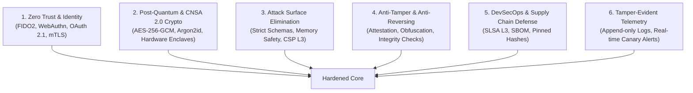

# Military-Grade Cyberdefense & Application Hardening (DEFCON-1)

This skill equips Antigravity with military-grade cyberdefense engineering protocols. Its objective is to **prevent hacks, stop intrusions, eliminate attack surfaces, and immunize codebases** across all platforms (Web, Android, iOS, macOS, Windows, Linux, and Cloud/API backends).

> **Core Philosophy:** "Assume breach. Verify explicitly. Minimize blast radius. Enforce Zero Trust at every interface."

---

## Operating Modes

When activated or consulted in Antigravity, this skill operates under two complementary modes:

### 1. Active Hardening Mode (Defense-by-Design)
Used when writing new code, implementing authentication, architecting features, or setting up deployment pipelines:
- Injects defensive controls into code before release.
- Enforces strict input validation, hardware-backed keystores, memory safety, and tamper resistance.
- Ensures all APIs, databases, and network transports adhere to defense-in-depth baselines.

### 2. Defensive Audit & Threat Neutralization Mode (Immunization)
Used when inspecting an existing codebase or preparing for production release:
- Evaluates the repository against **OWASP ASVS Level 3** (the highest level of verification for mission-critical software).
- Runs automated threat modeling (STRIDE / MITRE ATT&CK matrix).
- Identifies single points of failure, cryptographic weaknesses, sensitive data leaks, and insecure defaults, generating the exact patch to eliminate them.

### Distinction: Automated Tools vs. Architectural Recommendations
- **Automated Verification Tools (Executable & Tested):** Autonomous Python & PowerShell scripts (`scripts/check-security-baseline.py`, `check-dependencies-osv.py`, `check-file-integrity.py`, `check-live-endpoint.py`, `patch-and-reverify.py`, `sync-and-validate.py`) and CI/CD pipelines (`defense-gate.yml`) with zero external pip dependencies.
- **Architectural Recommendations & Hardening Templates:** Guidelines (`references/*.md`) and declarative templates (`templates/Dockerfile.hardened`, `docker-compose.hardened.yml`, `cloudflare-waf-rules.json`, `cloudflare-waf.tf`, `nginx.hardened.conf`, `k8s-network-policy.yaml`) that serve as recommended patterns to be tailored, implemented, and validated in the target project.

---

## The 6 Pillars of Military-Grade Cyberdefense

Every project defended under this skill must enforce these 6 fundamental pillars:

1. **Zero Trust & Continuous Verification (`references/ZERO-TRUST-AND-AUTH.md`):** Never trust network perimeters or client state. Authenticate and authorize every single request with cryptographically signed tokens, contextual posture, and least privilege.
2. **CNSA 2.0 Cryptography (`references/CRYPTOGRAPHY-STANDARDS.md`):** Strictly forbid legacy or weak algorithms (MD5, SHA1, DES, 3DES, RC4, RSA < 3072, plain ECB/CBC modes). Mandate authenticated encryption (AES-256-GCM, ChaCha20-Poly1305), memory-hard hashing (Argon2id), and hardware-backed keys.
3. **Platform & Runtime Hardening (`references/PLATFORM-HARDENING.md`):** Native defenses tailored to target platforms:
   - **Web:** CSP Level 3 without `unsafe-inline`, strict CORS, HSTS preload, Subresource Integrity (SRI), Trusted Types.
   - **Android:** Android Keystore/StrongBox, SafetyNet/Play Integrity, certificate pinning, Root/Frida detection, `FLAG_SECURE`, R8 obfuscation.
   - **iOS / macOS:** Secure Enclave, App Attest, hardened runtime, anti-debugging, memory tagging.
   - **APIs & Backends:** Rate limiting, DDoS mitigation, schema validation (Zod/Pydantic), parameterized queries, strict security headers.
4. **Anti-Tampering & Anti-Reverse Engineering (`references/ANTI-TAMPER-AND-RESILIENCE.md`):** Defense against runtime injection, dynamic binary instrumentation (Frida), memory dumping, repackaging, and code patching.
5. **Supply Chain & DevSecOps Defense (`references/DEVSECOPS-AND-SUPPLY-CHAIN.md`):** Hermetic builds, dependency lockfiles with cryptographic hash verification, Software Bill of Materials (SBOM), secrets pre-commit screening, and SLSA Level 3 compliance.
6. **Tamper-Evident Auditing & Intrusion Detection (`references/LOGGING-AND-TELEMETRY.md`):** Structured, sanitized audit trails with HMAC/hash-chaining to detect log tampering, coupled with honeypots and canary tokens.

---

## Defensive Execution Workflow

When auditing or hardening a codebase, execute the following protocol:

### Phase 1: Threat Surface Mapping (STRIDE)
1. Identify all ingress/egress points (public endpoints, deep links, IPC sockets, Bluetooth/NFC, user uploads, environment variables).
2. Map trust boundaries: Where does unauthenticated data enter? Where do elevated privileges execute?
3. Classify threats using STRIDE:
   - **S**poofing identity
   - **T**ampering with data/memory
   - **R**epudiation
   - **I**nformation disclosure (leaks)
   - **D**enial of service
   - **E**levation of privilege

### Phase 2: Static Defense Verification & SARIF Generation
Scan the repository using the included automated defense scanner (`scripts/check-security-baseline.ps1` or `scripts/check-security-baseline.py`):
- Run full scan or differential scan on staged files (`-GitDiff` / `--diff`).
- Export standard OASIS SARIF 2.1.0 report (`-OutputSarif security.sarif` / `--sarif security.sarif`) for inline visual annotations in the IDE and GitHub Security tab.
- Detects:
  - Hardcoded secrets or tokens.
  - Insecure network security configs (cleartext traffic permitted).
  - Missing cryptographic salt/IV randomness or broken ciphers (MD5, SHA1, AES-ECB).
  - Dynamic code evaluation (`eval()`, unsafe reflection, shell execution).
  - SQL / NoSQL / Command injection vectors.

### Phase 3: Cryptographic & Secret Isolation Check
- Are secrets stored in plain text or `.env` files committed to version control? (Mandate environment-based injection or Vault/Secret Manager).
- Are mobile credentials stored in `SharedPreferences` / `UserDefaults`? (Migrate immediately to Android Keystore / iOS Keychain).
- Is communication encrypted with TLS 1.3 and certificate pinning?

### Phase 4: Edge & Cloud Shielding
- Validate headers: `Content-Security-Policy`, `Strict-Transport-Security`, `X-Content-Type-Options: nosniff`, `X-Frame-Options: DENY`, `Permissions-Policy`.
- Configure Cloudflare / WAF rules: Rate limiting, Bot Fight Mode, DDoS threshold protection, geographic fencing when appropriate.

### Phase 5: Surgical Patching & Re-Verification Loop (Double Verification)
Apply remediations following the **Surgical Patch & Re-Verification Protocol** (`references/PATCH-AND-REVERIFY.md`):
1. **Baseline Capture:** Run existing test suites (`npm test`, `pytest`, `cargo test`) before modifying code.
2. **Minimal Effective Fix:** Generate surgical unified diff enforcing the security invariant at the closest trusted point.
3. **Defect Elimination Check:** Re-run the baseline scanner against the patched file to verify 0 defects.
4. **Non-Regression Check:** Re-run the full functional test suite to certify existing business logic and UI were not broken.
5. **Auto-Rollback on Failure:** If functional tests fail or the security defect persists, immediately revert and escalate.

---

## Anti-Patterns & Prohibited Practices (Zero Tolerance)

1. **"Security through Obscurity":** Hiding secret keys in client-side source code, decompilable binaries, or mobile assets.
2. **Roll-Your-Own Crypto:** Implementing custom encryption, hashing, or random number generators instead of verified libsodium / Web Crypto / platform cryptographic primitives.
3. **Implicit Trust:** Trusting data coming from webhooks, cookies, client local storage, or headers without cryptographic signature verification.
4. **Permissive CORS:** Setting `Access-Control-Allow-Origin: *` with credentials enabled.
5. **Unbounded Processing:** Accepting files or requests without strict byte-size limits, MIME verification (magic bytes), and rate limits.
6. **Detailed Error Leaks:** Exposing stack traces, SQL errors, or internal system paths in API responses.

---

## Quick Reference to Deep Subdocs

- [Surgical Patch & Re-Verification Loop](references/PATCH-AND-REVERIFY.md)
- [AI, LLM & Model Context Protocol (MCP) Defense](references/AI-AND-LLM-DEFENSE.md)
- [Zero Trust & Authentication](references/ZERO-TRUST-AND-AUTH.md)
- [Cryptographic Standards (CNSA 2.0)](references/CRYPTOGRAPHY-STANDARDS.md)
- [Platform Hardening (Web, Android, iOS, Desktop, Cloud)](references/PLATFORM-HARDENING.md)
- [Anti-Tamper, Anti-Reversing & Integrity](references/ANTI-TAMPER-AND-RESILIENCE.md)
- [DevSecOps, SBOM & Supply Chain](references/DEVSECOPS-AND-SUPPLY-CHAIN.md)
- [Tamper-Evident Telemetry & Incident Response](references/LOGGING-AND-TELEMETRY.md)
- [Operator & Workstation Hardening](references/OPERATOR-AND-WORKSTATION-HARDENING.md)
- [OWASP ASVS Level 3 Checklist](references/OWASP-ASVS-L3-CHECKLIST.md)

