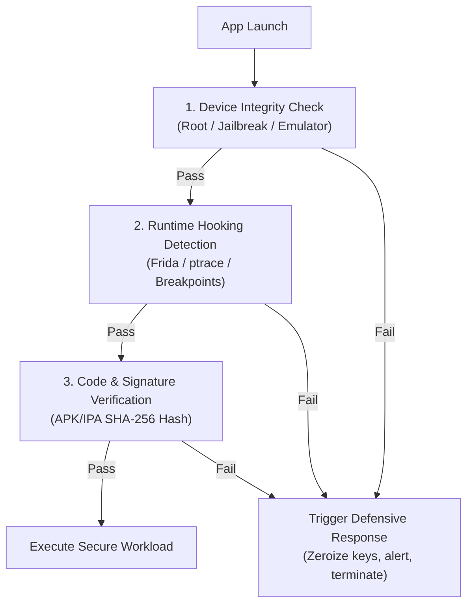

# Anti-Tamper, Anti-Reversing & Runtime Application Self-Protection (RASP)

Client applications (Mobile, Desktop, Web WASM) operate in zero-trust environments where adversaries can run debuggers, decompile bytecode, hook functions, and alter memory. This specification outlines active and passive defenses against reverse engineering and runtime attacks.

---

## 1. Threat Models in Hostile Environments

1. **Static Analysis & Decompilation:** Reconstructing source code with JADX, Ghidra, IDA Pro, Hopper, or APKTool.
2. **Dynamic Binary Instrumentation (DBI):** Injecting hooks and modifying memory at runtime using tools like **Frida**, Xposed, Substrate, or Cycript.
3. **Environment Spoofing & Emulation:** Running on rooted/jailbroken devices, emulators, or sandboxes to bypass hardware integrity checks.
4. **Repackaging & Code Patching:** Cracking the app, removing security checks, re-signing, and redistributing.

---

## 2. Multi-Layer Anti-Tamper Controls



---

## 3. Implementation Details

### A. Dynamic Instrumentation (Frida) Detection
Adversaries use Frida to bypass SSL pinning, dump encryption keys, and flip boolean returns. Detect Frida through multiple independent indicators:

1. **Port Scanning:** Detect Frida's default listening ports (`27042`, `27043`):
   ```c
   // C/Native check: probe local loopback ports
   struct sockaddr_in sa;
   sa.sin_family = AF_INET;
   sa.sin_port = htons(27042);
   inet_aton("127.0.0.1", &sa.sin_addr);
   int sock = socket(AF_INET, SOCK_STREAM, 0);
   if (connect(sock, (struct sockaddr*)&sa, sizeof(sa)) == 0) {
       // Frida server active! Alert and abort.
       trigger_security_kill();
   }
   close(sock);
   ```

2. **Memory Map Inspection (`/proc/self/maps` on Linux/Android):**
   Search for Frida-specific artifacts in memory (`frida-agent.so`, `frida-gadget.so`, `gum-js-loop`, `linjector`):
   ```c
   FILE *fp = fopen("/proc/self/maps", "r");
   char line[512];
   while (fgets(line, sizeof(line), fp)) {
       if (strstr(line, "frida") || strstr(line, "gum-js") || strstr(line, "xposed")) {
           fclose(fp);
           trigger_security_kill();
       }
   }
   fclose(fp);
   ```

3. **Inline Hook Detection:** Compare initial bytes of critical native libc functions (`open`, `connect`, `ptrace`, `ssl_read`) against standard prologue assembly instructions. If a jump/patch (`jmp`, `b`, `ldr pc`) is found, the function has been hooked.

---

### B. Device Integrity (Root & Jailbreak Detection)

- **Android:**
  - Check for test-keys build tags: `android.os.Build.TAGS.contains("test-keys")`.
  - Check for root binaries across standard paths: `/system/bin/su`, `/system/xbin/su`, `/sbin/su`, `/system/app/Superuser.apk`, `/data/local/bin/su`, `/data/local/xbin/su`.
  - Query **Google Play Integrity API** with cryptographic nonce to obtain an attestation token signed by Google servers.
- **iOS:**
  - Probe sandbox violations (e.g., attempting to write a file outside the sandbox directory `/private/jailbreak_test.txt`).
  - Check for jailbreak file artifacts (`/Applications/Cydia.app`, `/Library/MobileSubstrate/MobileSubstrate.dylib`, `/bin/bash`, `/usr/sbin/sshd`).
  - Query **Apple App Attest** to prove the app binary is untouched and running on a genuine Apple device.

---

### C. Binary & Bytecode Obfuscation

1. **Android (R8 / ProGuard / DexGuard):**
   Enable aggressive shrinking, obfuscation, and optimization:
   ```properties
   # proguard-rules.pro
   -repackageclasses 'a'
   -allowaccessmodification
   -overloadaggressively
   -flattenpackagehierarchy
   -assumenosideeffects class android.util.Log {
       public static *** d(...);
       public static *** v(...);
       public static *** i(...);
   }
   ```
2. **Native Code (OLLVM / Hikari / Rust):**
   - Control Flow Flattening (breaks IDA Pro graph analysis).
   - String Encryption: Never leave sensitive strings (URLs, error messages, regexes) in plaintext in binary `.rodata`. Decrypt in-place using stack strings or compile-time XOR macros.
   - Instruction Substitution and dead code insertion.

---

### D. Windows Native Anti-Debugging (Neutralizing x64dbg & Ring-3 Debuggers)

On Windows desktop binaries (C/C++, Rust, Go), reverse engineers rely on **x64dbg** and plugins like **ScyllaHide** to hook APIs, set hardware breakpoints, and alter memory registers. To defend against x64dbg:

1. **Direct TEB/PEB Inspection (Bypassing Hooked APIs):**
   Standard APIs like `IsDebuggerPresent()` are easily hooked by ScyllaHide. Inspect the Process Environment Block (PEB) directly via segment registers:
   ```c
   #include <windows.h>
   #include <winternl.h>

   bool detect_peb_debugger(void) {
   #if defined(_WIN64)
       // Read PEB pointer from GS register on x64 (offset 0x60)
       unsigned char* peb = (unsigned char*)__readgsqword(0x60);
       unsigned char being_debugged = peb[2]; // BeingDebugged flag
       DWORD nt_global_flag = *(DWORD*)(peb + 0xBC); // NtGlobalFlag offset
   #else
       // Read PEB pointer from FS register on x86 (offset 0x30)
       unsigned char* peb = (unsigned char*)__readfsdword(0x30);
       unsigned char being_debugged = peb[2];
       DWORD nt_global_flag = *(DWORD*)(peb + 0x68);
   #endif
       // 0x70 = FLG_HEAP_ENABLE_TAIL_CHECK | FLG_HEAP_ENABLE_FREE_CHECK | FLG_HEAP_VALIDATE_PARAMETERS
       if (being_debugged || (nt_global_flag & 0x70)) {
           return true; // x64dbg active!
       }
       return false;
   }
   ```

2. **Kernel Debug Port Query (`NtQueryInformationProcess`):**
   Query the kernel directly using internal system calls:
   ```c
   typedef NTSTATUS(NTAPI* pfnNtQueryInformationProcess)(HANDLE, ULONG, PVOID, ULONG, PULONG);

   bool detect_kernel_debug_port(void) {
       HMODULE ntdll = GetModuleHandleA("ntdll.dll");
       pfnNtQueryInformationProcess NtQueryInfo = (pfnNtQueryInformationProcess)GetProcAddress(ntdll, "NtQueryInformationProcess");
       if (!NtQueryInfo) return false;

       DWORD_PTR debugPort = 0;
       // ProcessDebugPort = 7
       NTSTATUS status = NtQueryInfo(GetCurrentProcess(), 7, &debugPort, sizeof(debugPort), NULL);
       return (status == 0 && debugPort != 0);
   }
   ```

3. **Hardware Breakpoint Detection (`DR0 - DR3` Registers):**
   x64dbg sets hardware execution breakpoints in CPU debug registers. Inspect the thread context directly:
   ```c
   bool detect_hardware_breakpoints(void) {
       CONTEXT ctx = { 0 };
       ctx.ContextFlags = CONTEXT_DEBUG_REGISTERS;
       HANDLE hThread = GetCurrentThread();
       if (GetThreadContext(hThread, &ctx)) {
           if (ctx.Dr0 || ctx.Dr1 || ctx.Dr2 || ctx.Dr3) {
               return true; // Hardware breakpoint detected!
           }
       }
       return false;
   }
   ```

4. **Thread Hiding from Debuggers (`ThreadHideFromDebugger`):**
   Instruct the Windows kernel to detach and blind any user-mode debugger from the current thread:
   ```c
   typedef NTSTATUS(NTAPI* pfnNtSetInformationThread)(HANDLE, ULONG, PVOID, ULONG);

   void hide_thread_from_x64dbg(void) {
       HMODULE ntdll = GetModuleHandleA("ntdll.dll");
       pfnNtSetInformationThread NtSetInfo = (pfnNtSetInformationThread)GetProcAddress(ntdll, "NtSetInformationThread");
       if (NtSetInfo) {
           // ThreadHideFromDebugger = 0x11
           NtSetInfo(GetCurrentThread(), 0x11, NULL, 0);
       }
   }
   ```

5. **Timing Latency Detection (`__rdtsc`):**
   Human reverse engineers in x64dbg step through instructions line-by-line. Measure CPU clock cycles across critical routines:
   ```c
   #include <intrin.h>

   void execute_timed_block(void) {
       unsigned __int64 start = __rdtsc();
       // Critical security check here
       unsigned __int64 elapsed = __rdtsc() - start;
       if (elapsed > 0xFFFFF) { // Unrealistic execution time = interactive debugging!
           trigger_security_kill();
       }
   }
   ```

---

## 4. Defensive Action on Breach Detection

When a tamper attempt, debugger, or rooted environment is detected:

1. **Immediate Key Zeroization:** Overwrite all cryptographic keys, tokens, and sensitive data in RAM with zeros immediately.
2. **Silent Deception (Honeypotting):** Rather than crashing immediately (which teaches the reverse engineer where the check is), silently feed corrupt/dummy data or delay responses randomly to exhaust the attacker's time.
3. **Out-of-Band Security Alert:** Dispatch an encrypted, non-blocking telemetry event to the SIEM / Security Operations Center with device fingerprint and detection flags.
4. **Safe Termination:** Terminate the process cleanly using kernel exit (`exit(0)` or `_exit(1)`), avoiding traceable panic stack traces.

