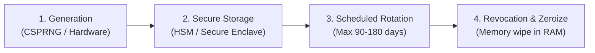

# Cryptographic Standards & Post-Quantum Readiness (CNSA 2.0 / NIST)

All cryptographic implementations in projects audited or built with this skill must adhere to the **National Security Agency Commercial National Security Algorithm (CNSA 2.0)** and **NIST SP 800-175B** standards.

---

## 1. Algorithm Allowlist & Deprecation Matrix

| Category | APPROVED (Military / Defense Grade) | PROHIBITED (Immediate Defect) |
| :--- | :--- | :--- |
| **Symmetric Encryption** | **AES-256-GCM** (Galois/Counter Mode)<br/>**ChaCha20-Poly1305** (RFC 8439) | AES-ECB, AES-CBC without HMAC, DES, 3DES, Blowfish, RC4, RC2 |
| **Password Hashing** | **Argon2id** (RFC 9106, $m \ge 64\text{MB}, t \ge 3, p \ge 4$)<br/>*Fallback:* **scrypt** or **PBKDF2-HMAC-SHA512** ($\ge 600,000$ iterations) | MD5, SHA-1, plain SHA-256/512, NTLM, LM, unsalted hashes, bcrypt with low work factor |
| **Digital Signatures** | **Ed25519** (RFC 8032)<br/>**ECDSA** (NIST P-384, P-521 with SHA-384+)<br/>**RSA** $\ge 4096$ bits (PSS padding only) | RSA $\le 2048$ bits, RSA PKCS#1 v1.5 padding, DSA, ECDSA with P-192 or P-224 |
| **Key Agreement** | **X25519** (RFC 7748)<br/>**ECDH** (P-384 with SHA-384)<br/>**ML-KEM / Kyber** (Post-Quantum Hybrid) | Diffie-Hellman groups $< 2048$ bits, unauthenticated DH |
| **Cryptographic Hashing** | **SHA-384**, **SHA-512**, **SHA3-384**, **BLAKE3**, **BLAKE2b** | MD2, MD4, MD5, SHA-0, SHA-1 |
| **Key Derivation (KDF)** | **HKDF-SHA512** (RFC 5869), **Argon2id** | Custom string concatenations, MD5/SHA1 KDFs |
| **Random Number Gen** | OS Cryptographic CSPRNG (`/dev/urandom`, `getrandom()`, `crypto.getRandomValues()`, `SecRandomCopyBytes`, `BCryptGenRandom`) | `Math.random()`, `rand()`, `java.util.Random`, seeded LCGs |

---

## 2. Hardened Key Lifecycle Management



### A. Zeroization of Sensitive Key Material (Compiler Optimization Defense)
Never leave plaintext keys in garbage-collected memory longer than needed.
> **Trail of Bits Security Directive:** Compilers (GCC, Clang, Rustc, MSVC) aggressively perform **Dead Store Elimination (DSE)**. A standard call like `memset(key, 0, len)` will be **silently discarded** by the compiler if the buffer is not read again before function return, leaving encryption keys exposed in raw RAM.

To guarantee true memory zeroization across languages:
- **C/C++ (Linux/macOS):** Use `explicit_bzero()` or `sodium_memzero()`. Never use plain `memset()`.
- **C/C++ (Windows):** Use `SecureZeroMemory()` or `RtlSecureZeroMemory()` (guaranteed not to be optimized away by MSVC).
- **Rust:** Use the `zeroize` crate with `ZeroizeOnDrop` or `secrecy::Secret<T>`.
- **Go:** Use `memguard` or `crypto/subtle.XORBytes` to scrub byte slices before garbage collection.
- **Java/Kotlin:** Use `char[]` and `byte[]` and overwrite explicitly with `Arrays.fill(keyBytes, (byte) 0);`. Never use `java.lang.String` for passwords or keys (Strings are immutable in the JVM string pool and cannot be scrubbed from RAM).

### B. Hardware-Backed Keystores
Never store private keys in database files, SharedPreferences, or unencrypted local files:
- **Android:** Utilize **Android Keystore** with `KeyProperties.PURPOSE_ENCRYPT | KeyProperties.PURPOSE_DECRYPT`, setting `setIsStrongBoxBacked(true)` when hardware StrongBox is available.
- **iOS / macOS:** Utilize the **Keychain Services API** with `kSecAttrAccessibleAfterFirstUnlockThisDeviceOnly` and `kSecAccessControlBiometryAny` backed by the **Apple Secure Enclave**.
- **Windows:** Utilize **Windows DPAPI** (`CryptProtectData`) or TPM 2.0 Platform Crypto Provider.
- **Linux / Cloud:** Utilize **HashiCorp Vault**, AWS KMS, or Azure Key Vault with HSM protection (FIPS 140-3 Level 3).

---

## 3. Safe Cryptographic Implementation Patterns

### Pattern 1: Authenticated Encryption with AES-256-GCM (TypeScript / Node Web Crypto)
```typescript
import { webcrypto } from 'node:crypto';

export async function encryptData(plaintext: Uint8Array, key: CryptoKey): Promise<{ ciphertext: Uint8Array; iv: Uint8Array }> {
  // CRITICAL: 96-bit (12-byte) IV generated uniquely per encryption. NEVER reuse an IV!
  const iv = webcrypto.getRandomValues(new Uint8Array(12));
  
  const ciphertextBuffer = await webcrypto.subtle.encrypt(
    { name: 'AES-GCM', iv, tagLength: 128 },
    key,
    plaintext
  );
  
  return {
    ciphertext: new Uint8Array(ciphertextBuffer),
    iv
  };
}
```

### Pattern 2: Constant-Time Comparison (Preventing Timing Attacks)
Never use standard equality (`===` or `strcmp`) when comparing HMACs, signatures, or passwords:
```typescript
import { timingSafeEqual } from 'node:crypto';

export function verifyMac(a: Buffer, b: Buffer): boolean {
  if (a.length !== b.length) {
    return false; // Or run dummy constant-time comparison to prevent length leak
  }
  return timingSafeEqual(a, b);
}
```

---

## 4. Transport Layer Defense (TLS 1.3 Baseline)

- **Version Requirement:** Enforce **TLS 1.3** as default; TLS 1.2 is only permitted with strict forward-secret cipher suites (`ECDHE-ECDSA-AES256-GCM-SHA384`, `ECDHE-RSA-AES256-GCM-SHA384`).
- **Completely Ban:** SSL 2.0, SSL 3.0, TLS 1.0, TLS 1.1.
- **Perfect Forward Secrecy (PFS):** Mandatory. Compromise of the server private key must never decrypt past recorded sessions.
- **Certificate Pinning (Mobile/Desktop):** Pin against the public key hash (SPKI Pinning) of the intermediate certificate authority, with a verified backup pin to avoid bricking applications upon certificate renewal.

---

## 5. Post-Quantum Cryptography (PQC) Migration Guide (CNSA 2.0 Mandate)

CNSA 2.0 mandates that **new systems must support post-quantum algorithms by 2025** and must exclusively use them by 2030. The transition strategy is **hybrid construction** — combining a classical algorithm with a post-quantum algorithm so that security holds even if one is broken.

### Recommended Hybrid Key Agreement: X25519 + ML-KEM-768

```typescript
// Conceptual hybrid KEM construction (TypeScript pseudocode)
// Step 1: Classical key agreement — X25519 (RFC 7748)
const classicalSecret = await x25519.keyAgreement(myPrivKey, peerPubKey);

// Step 2: Post-quantum key encapsulation — ML-KEM-768 (NIST FIPS 203)
const { sharedSecret: pqSecret, ciphertext } = await mlkem768.encapsulate(peerMlkemPubKey);

// Step 3: Combine both secrets via HKDF-SHA512 (RFC 5869)
// Security holds as long as EITHER X25519 OR ML-KEM-768 remains secure.
const hybridSecret = await hkdf('SHA-512', concat(classicalSecret, pqSecret), salt, info, 32);
```

### Standards Reference
| Algorithm | Standard | Security Level | Mandate |
| :--- | :--- | :--- | :--- |
| **ML-KEM-768** (Kyber) | NIST FIPS 203 | NIST Level 3 (≈AES-192) | Required for new systems by 2025 |
| **ML-DSA-65** (Dilithium) | NIST FIPS 204 | NIST Level 3 | Required for new digital signatures by 2025 |
| **SLH-DSA** (SPHINCS+) | NIST FIPS 205 | NIST Level 3 | Stateless hash-based signature fallback |

### Migration Timeline
- **2024–2025:** Add PQC support alongside classical algorithms (hybrid mode).
- **2026–2029:** Phase out standalone classical key agreement for new deployments.
- **2030:** All NSS systems must use PQC exclusively per CNSA 2.0 directive.

> [!TIP]
> Use the [Open Quantum Safe](https://openquantumsafe.org/) (`liboqs`) library for language bindings until native platform support (Node.js WebCrypto, OpenSSL 3.x) stabilizes for FIPS 203/204/205.

