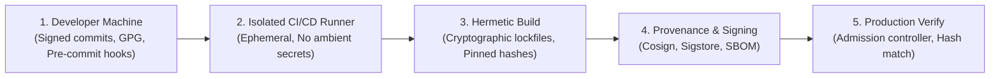

# DevSecOps, Supply Chain Defense & SLSA Level 3

Modern software builds are prime targets for supply chain poisoning, malicious dependency injection (typosquatting), and compromised CI/CD runners. This guide defines controls required to secure the build pipeline from commit to deployment.

---

## 1. Supply Chain Defense Principles (NIST SSDF & SLSA)



---

## 2. Dependency Locking & Integrity Verification

1. **Mandatory Cryptographic Hashes in Lockfiles:**
   - **Node.js (npm/pnpm/yarn):** Ensure `package-lock.json` contains SHA-512 `integrity` hashes for every tarball. Run with `npm ci --ignore-scripts` to prevent arbitrary postinstall script execution during installs.
   - **Rust (Cargo):** Commit `Cargo.lock` with sha256 checksums.
   - **Python:** Use `poetry.lock` or `pip compile --generate-hashes` with exact hashes.
   - **Go:** Commit `go.sum` with verified checksums.

2. **Dependency Confusion & Typosquatting Defense:**
   - Always scope private packages under an organizational namespace (e.g., `@mycompany/core`).
   - Configure `.npmrc` / `pip.conf` with explicit registry routing so private names can never resolve to public npmjs/PyPI registries.

3. **Automated Vulnerability Gate in CI & Real-Time OSV.dev Scanning:**
   Never rely solely on static checks. Continually match all direct and transitive dependencies against **Google OSV.dev** (Open Source Vulnerabilities database):
   - **Local Scanning:** Run our zero-dependency scanner:
     ```bash
     python scripts/check-dependencies-osv.py . --sarif osv-report.sarif
     ```
   - **Official Google OSV-Scanner CLI:**
     ```bash
     osv-scanner --lockfile=package-lock.json --format=sarif --output=osv.sarif
     ```
   - **Enforcement Policy:** Fail the build automatically if any direct or transitive dependency contains a CVE with CVSS $\ge 7.0$ (High/Critical) or an unpatched advisory in OSV.dev.

---

## 3. Secret Leak Prevention & SecretOps (Infisical / Zero-Knowledge Baseline)

Never allow passwords, private keys, or API tokens to enter git history or sit unencrypted on developer disks:

1. **Zero Plaintext Secrets on Disk (In-Memory Injection):**
   Infostealer malware (RedLine, Lumma, Vidar) and malicious editor plugins actively scan developer hard drives for `.env` files.
   - **Doctrina:** Never persist production secrets in `.env` files on local workstations.
   - **In-Memory Secret Injection:** Use modern SecretOps tools (**Infisical**, HashiCorp Vault, or AWS Secrets Manager) to inject credentials directly into process RAM at runtime:
     ```bash
     # Secrets are injected strictly in memory; zero plaintext files written to disk
     infisical run --env=production -- npm start
     ```
   - Commit only sanitized `.env.example` templates containing dummy variable names (`API_KEY=YOUR_KEY_HERE`).

2. **Automated Secret Rotation Lifecycle (NIST SP 800-57):**
   - **Operational Keys:** Rotate external API keys and database credentials automatically every 30 to 90 days.
   - **Ephemeral / Dynamic Credentials:** For database migrations or CI/CD pipelines, generate Just-In-Time (JIT) credentials that automatically expire in 15 to 60 minutes.
   - **Immediate Revocation Protocol:** Immediately rotate and revoke credentials upon team member offboarding, device loss, or suspected compromise.

3. **Pre-Commit Hook Configuration (`.gitleaks.toml`):**
   Run local secret detection before every commit:
   ```bash
   # Example git pre-commit script
   gitleaks protect --staged --verbose --redact || {
     echo "CRITICAL: Secret detected in staged files. Commit aborted."
     exit 1
   }
   ```

4. **Active Credential Verification & Blast Radius (TruffleHog Protocol):**
   Passive regex detection generates false positives against test credentials or revoked strings. Military doctrine mandates **Active Verification** in CI/CD and incident response:
   - **Passive vs. Active:**
     - *Passive Detection (Gitleaks / Regex / Entropy):* Static local inspection in microseconds (ideal for Git pre-commit hooks).
     - *Active Verification (TruffleHog Live Probes):* Sends a non-destructive, authenticated query to the provider's API (AWS STS `GetCallerIdentity`, GitHub `/user`, OpenAI `/models`, Slack `auth.test`, Stripe `/v1/balance`).
   - **Finding Classification:**
     - `Verified: true`: **CRITICAL DEFCON-1 INCIDENT (ACTIVE BREACH).** The credential is live in production at this instant and permits real unauthorized access.
     - `Verified: false`: Revoked, expired, or test credential. Requires repository cleanup without a red operational alert.
   - **Live Credential Blast Radius Analysis:**
     Upon detecting `Verified: true`, query caller metadata to map the full scope before revoking:
     ```bash
     # AWS: Determine account, role, and permissions
     aws sts get-caller-identity
     # GitHub: Identify user and OAuth scopes (repo, admin:org, etc.)
     curl -s -I -H "Authorization: Bearer ghp_TOKEN" https://api.github.com/user | grep "X-OAuth-Scopes"
     ```
   - **Immediate Containment Protocol:**
     1. Revoke the key immediately in the provider's console or API.
     2. Audit access logs (AWS CloudTrail, GitHub Audit Log, Stripe Event Logs) filtering by the compromised credential identifier to determine data exfiltration scope.
     3. Issue a new ephemeral key injected in-memory via SecretOps (Infisical).
     4. Purge Git history with `git-filter-repo`.

6. **Ephemeral CI Runner Environment:**
   - Never pass long-lived cloud credentials to CI runners.
   - Use **OIDC Workload Identity Federation** (e.g., GitHub Actions OIDC to AWS IAM / GCP Workload Identity) to exchange short-lived tokens on-the-fly.

---

## 4. Software Bill of Materials (SBOM) & Provenance

1. **Generate SBOM on Every Build:**
   Generate CycloneDX or SPDX JSON during release workflows:
   ```bash
   syft dir:. -o cyclonedx-json=build/sbom.cdx.json
   ```
2. **Sign Build Artifacts with Cosign (Sigstore):**
   Cryptographically sign container images and binaries with keyless OIDC signatures:
   ```bash
   cosign sign --yes ghcr.io/myorg/myapp:v1.0.0
   ```
3. **Verify at Deployment Time:**
   Production clusters and container runtimes (Kubernetes Kyverno / Gatekeeper) must refuse to launch any artifact lacking a valid cryptographic signature and verified SBOM.

