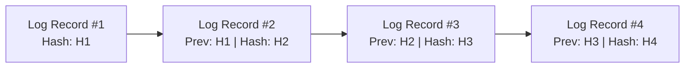
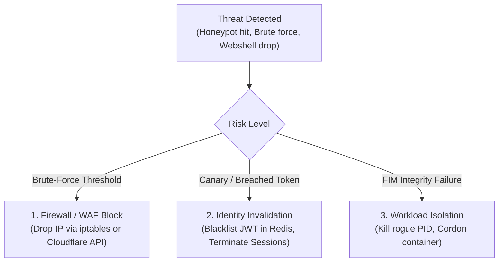

# Tamper-Evident Telemetry & Incident Response

Security logs are prime targets for attackers seeking to cover their tracks. This specification establishes standards for cryptographically protected, tamper-evident audit trails and active intrusion traps (canary tokens).

---

## 1. Cryptographically Chained Audit Logging (Hash Chaining)

To detect if an attacker or rogue administrator modified or deleted log entries, each security log record must be cryptographically linked to the previous record using a hash chain (Merkle-style):



### Algorithm
For each log entry $i$:
$$\text{EntryHash}_i = \text{HMAC-SHA384}(K_{\text{audit}}, \text{EntryHash}_{i-1} \parallel \text{Timestamp}_i \parallel \text{Actor}_i \parallel \text{Action}_i \parallel \text{Payload}_i)$$
If any line is modified, deleted, or inserted out of sequence, the hash chain breaks immediately during verification.

---

## 2. Zero-PII Log Sanitization & Anti-Log Injection

### A. Prevention of Log Injection (CRLF Attacks)
Attackers inject newline characters (`\r\n` / `%0d%0a`) into user inputs to forge fake log lines.
- **Rule:** Sanitize all untrusted variables before writing to logs. Replace newlines and non-printable ASCII characters:
  ```typescript
  export function sanitizeForLog(input: string): string {
    return input.replace(/[\r\n\t]/g, '_').substring(0, 500);
  }
  ```

### B. Prohibited Log Data (Zero Leakage)
Under no circumstances may the following appear in logs, debug consoles, or error messages:
- Passwords, passphrases, PINs.
- Session tokens, Bearer tokens, API keys, private keys.
- Credit card numbers (PAN), CVVs, bank account numbers.
- Personally Identifiable Information (PII) like Government IDs, SSNs, medical data.

---

## 3. Active Intrusion Traps (Canary Tokens & Honeypots)

Do not rely solely on passive firewall logs. Plant active detection traps across the application:

1. **Decoy API Endpoints (Honeypot URLs):**
   Expose unlinked administrative URLs (e.g., `/admin/phpmyadmin`, `/api/v1/internal/debug-dump`, `/.env`). Any request reaching these routes triggers an immediate **Severity 1 (Critical) Alert** and blocks the source IP, as legitimate users never navigate to them.

2. **Canary Database Credentials:**
   Place decoy tables or fake credentials in database backups. If a canary credential is ever used, the security team knows a database exfiltration occurred.

3. **Canary AWS / Cloud Keys:**
   Seed decoy API keys in non-production code repositories. If the key is queried, an automated webhook notifies the security team with the attacker's IP and user agent.

---

## 4. File Integrity Monitoring (FIM) & Runtime Tampering (Wazuh Doctrine)

In compromised environments, attackers alter configuration files, plant webshells, or trojanize core application binaries to establish persistence:

1. **Cryptographic Baseline Manifest:**
   During the build/deployment pipeline, generate a signed SHA-256 manifest of all application code, configuration files, and static assets:
   ```bash
   python scripts/check-file-integrity.py /app --init /etc/baseline.json
   ```
2. **Continuous & Periodic Runtime Verification:**
   Schedule or trigger integrity checks on running workloads:
   ```bash
   python scripts/check-file-integrity.py /app --verify /etc/baseline.json
   ```
   - **Tampered (Modified) Files:** Triggers an immediate **CRITICAL DEFCON-1** alarm.
   - **Untracked / Added Files (Potential Webshells):** Identifies files dropped by attackers (e.g., `.php`, `.jsp`, `.sh`, `.exe`) that were not present in the deployment manifest.
3. **Whodata Tracking (Auditd / Sysmon Integration):**
   Where host agents are available, link file change events to the specific **Process ID (PID)**, parent binary, and authenticated **User ID** responsible for the modification.

---

## 5. Active Response & Automated Threat Neutralization

Passive alerting is insufficient against automated attack toolkits. Security systems must execute deterministic countermeasures upon high-fidelity detections:



1. **Automated Edge & Host IP Blocking:**
   - When an IP hits a honeypot route (`/admin/phpmyadmin`, `/.env`) or exceeds 5 failed login attempts in 60 seconds, trigger an automated Active Response:
     - Cloudflare WAF API: Add IP to dynamic blocklist for 24 hours.
     - Linux Host: Add IP to `iptables -A INPUT -s <IP> -j DROP`.
2. **Automated Credential & Session Invalidation:**
   - If a canary token is invoked, immediately invalidate all active sessions and refresh tokens tied to the corresponding tenant in Redis cache.
3. **Process & Workload Containment:**
   - If an unauthorized process attempts to modify a baseline-protected binary, terminate the process (`SIGKILL`), isolate the container (remove from load balancer pool), and dump memory forensics.

---

## 6. MITRE ATT&CK Telemetry Mapping

To provide actionable intelligence for Security Operations Centers (SOC), map all security telemetry to standard MITRE ATT&CK techniques:

| Telemetry Event | MITRE ATT&CK Technique | Severity | Automated Action |
| :--- | :--- | :--- | :--- |
| Honeypot Endpoint Hit | **T1595** (Active Scanning) | HIGH | IP Block (Edge WAF) |
| Multiple Failed Auth Attempts | **T1110** (Brute Force) | HIGH | Account Lockout + IP Throttle |
| Untracked File in Web Root | **T1505.003** (Web Shell) | CRITICAL | Quarantine File + Alert SOC |
| Log Chaining Hash Mismatch | **T1562.001** (Impair Defenses) | CRITICAL | Trigger Emergency Incident Protocol |
| SSRF Attempt to Metadata IP | **T1552.005** (Cloud Instance Metadata) | CRITICAL | Abort Request + Blacklist Origin |

