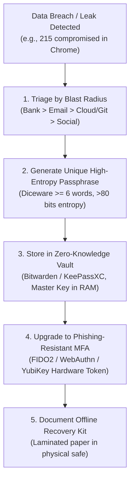

# Operator, Workstation & Personal Security Hardening (DEFCON-1 Operator Standard)
### Inspired by Alicia Sykes' Personal Security Checklist & NIST SP 800-63B

A cyberdefense suite is only as resilient as the **workstations, identities, and credentials of the human engineers and operators** who build and administer it. If an attacker compromises a developer's laptop via an *infostealer* trojan, steals unencrypted browser cookies, or intercepts an SMS 2FA code, all downstream application hardening can be bypassed.

This specification defines the mandatory personal security, credential hygiene, and workstation lockdown standards required for operators and software engineers.

---

## 1. Master Credential Hygiene & Password Triage (Resolving Breaches)



### A. The Infostealer Threat to Browser Passwords
Infostealer malware (Lumma, RedLine, Vidar, Stealc) specifically targets Chromium-based browsers (Chrome, Edge, Brave). They copy and decrypt `%LOCALAPPDATA%\Google\Chrome\User Data\Default\Login Data` and active session cookies in seconds.
- **Mandatory Directive:** Never store production passwords, database credentials, or sensitive portal logins inside browser built-in password managers.
- **Dedicated Zero-Knowledge Vault:** Use a dedicated password manager (**Bitwarden** or **KeePassXC**) utilizing Argon2id or PBKDF2 (minimum 600,000 iterations) with master passphrase encryption that never exposes credentials unencrypted to the disk.

### B. Credential Remediation Priority Matrix
When remediating leaked or weak passwords:
1. **Tier 1 (Critical):** Primary email accounts (email is the root of password reset chains for all other accounts), banking/financial portals, cloud providers (AWS, GCP, Azure), and Git hosting (GitHub, GitLab).
2. **Tier 2 (High):** Workstation logins, VPNs, password manager master key, and development servers.
3. **Tier 3 (Medium):** Social media, e-commerce, and communication tools.
4. **Tier 4 (Low):** Forums, newsletters, and throwaway services.

### C. Passphrase Entropy Standard
- Never create passwords based on personal information, dictionary words with simple substitutions (`P@ssw0rd!`), or recycled patterns.
- Mandate **Diceware Passphrases**: 5 to 7 completely random words selected from standard wordlists (e.g., `correct-horse-battery-staple-galaxy`), delivering $>80$ bits of true cryptographic entropy.

### D. Multi-Factor Authentication (MFA) Hierarchy
- **Tier 1 (Mandatory for Operators):** Hardware FIDO2 / WebAuthn Security Keys (YubiKey 5 Series, Google Titan). Cryptographically bound to the origin domain; immune to reverse-proxy phishing (Evilginx).
- **Tier 2 (Acceptable Alternative):** Hardware-bound TOTP authenticator app (RFC 6238) with biometric unlock (e.g., Aegis Authenticator, Ente Auth).
- **PROHIBITED:** SMS 2FA and voice call verification (vulnerable to SIM swapping, SS7 telecommunications eavesdropping, and carrier social engineering).

---

## 2. Developer Workstation OS Lockdown (Windows / macOS / Linux)

### A. Full Disk Encryption (FDE)
- **Windows:** BitLocker with TPM + Startup PIN (protects against DMA attacks and cold-boot physical memory dumping).
- **macOS:** FileVault with Secure Enclave hardware binding.
- **Linux:** LUKS2 with Argon2id key derivation and TPM2 auto-unlock.

### B. Firmware & Kernel Protection
- **Secure Boot & UEFI Password:** Enforce Secure Boot to prevent bootkits and unauthorized kernel loading. Set an administrative UEFI password to block booting from malicious USB drives.
- **Core Isolation & Memory Integrity (Windows HVCI):** Enable Hypervisor-Protected Code Integrity (HVCI) and Virtualization-Based Security (VBS) to prevent unsigned kernel-mode drivers from executing.

### C. Network Protocol Hardening on the Workstation
Disable legacy protocols frequently abused for internal network reconnaissance and spoofing:
```powershell
# Disable NetBIOS over TCP/IP (Windows PowerShell)
Get-WmiObject -Class Win32_NetworkAdapterConfiguration | Where-Object { $_.IPEnabled -eq $true } | ForEach-Object {
    $_.SetTcpipNetbios(2) # 2 = Disable NetBIOS
}

# Disable LLMNR (Link-Local Multicast Name Resolution) via Registry
New-ItemProperty -Path "HKLM:\SOFTWARE\Policies\Microsoft\Windows NT\DNSClient" -Name "EnableMulticast" -Value 0 -PropertyType DWORD -Force
```

### D. Screen Locking & Notification Privacy
- Set screen timeout lock to a maximum of **5 minutes** of inactivity.
- Disable display of notifications and message previews on lock screens (prevents physical observation of 2FA codes or sensitive messages).

---

## 3. Developer Identity & Supply Chain Security

### A. Cryptographic Git Commit Signing
Unsigned Git commits allow any actor to spoof commit authorship (`git commit --author="Linus Torvalds <torvalds@linux.org>"`).
- **Mandatory Signing:** Sign every commit with GPG or SSH keys:
  ```bash
  git config --global user.signingkey "ssh-ed25519 AAAAC3NzaC1yc2E..."
  git config --global gpg.format ssh
  git config --global commit.gpgsign true
  git config --global tag.gpgsign true
  ```
- Configure GitHub/GitLab to enforce **Vigilant Mode** (marking unsigned commits as unverified).

### B. Hardware-Backed SSH Keys (FIDO2 / YubiKey)
Never store raw, unprotected private SSH keys (`id_rsa` or `id_ed25519`) on developer hard drives.
- Generate hardware-backed FIDO2 SSH keys:
  ```bash
  ssh-keygen -t ed25519-sk -O resident -O verify-required -f ~/.ssh/id_ed25519_sk
  ```
- The private key cannot be extracted or stolen by malware; signing requires physical touch on the YubiKey.
- **Disable SSH Agent Forwarding:** Never use `ssh -A` to remote servers. Compromising the remote server allows attackers to hijack the forwarded local SSH agent.

---

## 4. Network, DNS & Browser Privacy

1. **Encrypted DNS with Threat Blocking (DoH / DoT):**
   Configure all developer devices and routers to use DNS-over-HTTPS with automated malware and phishing filtering:
   - **Quad9:** `9.9.9.9` / `https://dns.quad9.net/dns-query` (automated malicious domain blocking).
   - **Cloudflare Security:** `1.1.1.2` / `https://security.cloudflare-dns.com/dns-query`.
2. **Wi-Fi Lockdown:**
   - Enforce **WPA3-Personal** or **WPA3-Enterprise**.
   - Disable **WPS (Wi-Fi Protected Setup)** on routers (vulnerable to brute-force PIN attacks).
   - Isolate smart home / IoT devices on a dedicated, firewalled Guest VLAN away from development workstations.
3. **Browser Hardening:**
   - Install **uBlock Origin** (in hard/medium mode) to block malicious JavaScript, tracking beacons, and drive-by downloads.
   - Disable WebRTC local IP address leakage (`media.peerconnection.ice.default_address_only = true` in Firefox).
   - Isolate untrusted research and file downloads inside disposable containers or sandboxed virtual machines.

---

## 5. Physical & Travel Security Protocols

1. **Anti-Juice Jacking (Hardware USB Data Blockers):**
   Public USB charging stations (airports, hotels, cafes) can be compromised with malicious hardware that initiates automated data transfer (*juice jacking*). Always use a physical **USB data blocker** ("USB condom") that severs the data pins (D+ and D-) and connects only power pins (VCC and GND).
2. **Physical Camera & Audio Privacy:**
   Equip laptops with physical sliding webcam covers. For high-security facilities, use 3.5mm microphone jack suppressors or hardware microphone kill-switches.
3. **Tamper-Evident Physical Seals:**
   When crossing high-risk borders or leaving hardware unattended, place tamper-evident glitter seals or holographic security tape over chassis screw holes to detect physical hardware implanting.

