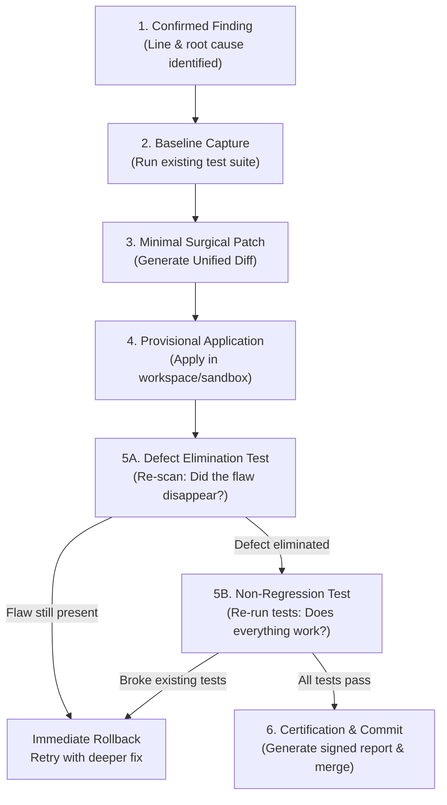

# Surgical Patch & Re-Verification Loop (Patch & Re-Verify)

Inspired by the audit architecture of `codex-security`, the **Surgical Patch & Re-Verification** protocol guarantees that **every detected vulnerability is resolved at its root cause without introducing regressions or breaking business functionality**.

> **Axiom:** "A patch that breaks the business is not a solution; a patch that fails to eliminate the root cause is not a cure. Remediation demands dual empirical proof: defect elimination + functional integrity."

---

## The 6-Phase Dual Verification Cycle



---

## Surgical Patch Execution Rules

### 1. Pre-Patch Blast Radius Calculation
Before altering a single line of code, calculate the impact radius of the affected function:
- **Incoming Dependencies:** Which other modules, controllers, or services import or invoke this method?
- **Interface Contract:** The patch must strictly preserve method signatures, return types, and documented error behaviors. Altering return types or throwing unhandled exceptions causes cascading failures in API consumers.
- **Test Scope:** If the modified file is a shared core helper (e.g., `authMiddleware`), the harness must run the test suites of all dependent modules, not merely unit tests for the edited file.

### 2. Minimal Effective Fix Invariant (Zero Bloat)
- The patch must contain **only the lines strictly necessary** to enforce the security invariant (e.g., parameterizing a query, adding Zod/Pydantic schema validation, or enforcing the `FLAG_SECURE` window attribute).
- **Prohibited:** Reformatting adjacent code, renaming unrelated variables, or rewriting whole modules during a security bugfix. Cosmetic changes dramatically elevate regression risk.

### 3. Where to Apply the Defense (Last Trusted Decision Point)
- The fix must be placed at the **decision point closest to the critical operation**:
  - In SQL Injections: at the database invocation layer (parameterization), never via magic regex filters on the frontend.
  - In IDOR Authorization: in the ORM `where` clause, strictly binding the authenticated `tenantId` or `userId`.
  - In Android Network Transports: in `res/xml/network_security_config.xml`, rather than relying on every developer remembering to prepend `https://`.

### 4. Empirical Re-Verification Procedure

For every defect discovered in a file `$TARGET_FILE`:

```text
[PHASE A] Pre-Patch Baseline Capture:
1. Run functional test suite: npm test / pytest / cargo test
2. Record baseline result: e.g., "142 passing, 0 failing".

[PHASE B] Surgical Patch Application:
3. Apply surgical unified diff to $TARGET_FILE.

[PHASE C] Security Verification (Did the vulnerability disappear?):
4. Run the baseline security scanner:
   python ./scripts/check-security-baseline.py $TARGET_FILE
   (or: powershell ./scripts/check-security-baseline.ps1 -TargetPath $TARGET_FILE)
5. IF the defect persists -> ABORT and immediately rollback:
   git checkout -- $TARGET_FILE

[PHASE D] Functional Integrity Verification (Did we break existing features?):
6. Re-run functional test suite: npm test / pytest / cargo test
7. IF any test fails -> ABORT and immediately rollback:
   git checkout -- $TARGET_FILE
8. IF all tests pass -> Patch is VALIDATED and CERTIFIED.
```

---

## 5. Proof-by-Exploitation Regression Testing (Shannon Methodology)

Inspired by the philosophy of autonomous pentesting (**Shannon**), a security finding is never certified as resolved simply because code "looks correct." It demands an **Executable Proof of Concept (PoC)**:

1. **Write the PoC Before Patching:** Author an automated regression test (following the `templates/security-poc-test.template.ts` pattern) that attempts the exploit (e.g., triggering an IDOR, injecting an SSRF payload to `169.254.169.254`, or requesting a path traversal).
2. **Empirical Reproduction:** On unpatched code, this test must fail or demonstrate an unauthorized breach.
3. **Post-Patch Certification:** Once the surgical patch is applied and the test is re-run, it **must pass cleanly**, proving that the endpoint safely neutralizes the payload with a controlled status code (`400 Bad Request` or `403 Forbidden`) and zero data leakage.
