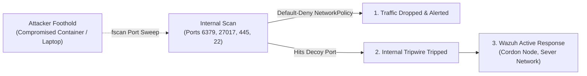

# Zero Trust Architecture & Hardened Identity (NIST SP 800-207)

In military-grade defense, the traditional perimeter defense model ("castle-and-moat") is dead. Zero Trust operates under one axiom: **Never trust, always verify, continuously validate.**

---

## 1. Zero Trust Architectural Principles

1. **Explicit Identity Verification:** Every human, service, bot, or internal microservice must authenticate on every request with strong cryptographic credentials.
2. **Least Privilege Enforcement (PoLP):** Limit access with Just-In-Time (JIT) and Just-Enough-Access (JEA) models. No broad root/admin access.
3. **Assume Breach:** Assume an adversary is already inside the network. Segment systems so that compromise of one node does not yield lateral movement to another.
4. **Data-Centric Security:** Protect data at rest, in transit, and in use, regardless of where it is stored or transported.

---

## 2. Authentication Standards

### A. Passwordless & Multi-Factor (MFA / FIDO2 / WebAuthn)
- **Mandate WebAuthn / Passkeys:** Hardware-backed authentication using platform authenticators (Face ID, Touch ID, Windows Hello, YubiKey). WebAuthn is inherently phishing-resistant because private keys never leave the hardware enclave and signatures are bound to the origin domain.
- **Deprecate Insecure MFA:** Strictly forbid SMS-based 2FA and unencrypted email codes (vulnerable to SIM swapping and SS7 interception). Mandate RFC 6238 TOTP (minimum 6 digits, SHA-256 or SHA-512) or FIDO2 hardware tokens.

### B. OAuth 2.1 & OpenID Connect (OIDC)
- **Always enforce PKCE (RFC 7636):** Mandate Proof Key for Code Exchange (S256) on **all** clients (single-page apps, mobile apps, and confidential web backends).
- **No Implicit Grants:** The OAuth implicit grant flow is completely banned due to URL fragment token leakage.
- **Short-Lived Access Tokens:** Maximum lifespan of 5 to 15 minutes.
- **Rotating Refresh Tokens:** Single-use refresh tokens with automatic reuse detection. If a refresh token is used twice, immediately invalidate the entire token family (attacker detected).
- **Token Binding:** Bind tokens to client TLS certificates (RFC 8705 mTLS token binding) or DPoP (RFC 9449 - Demonstrating Proof-of-Possession at the Application Layer) so stolen tokens cannot be replayed from another IP/device.

### C. JWT Security & Anti-Algorithm Confusion (Defense-in-Depth)
JSON Web Tokens (JWT) are susceptible to critical signature bypasses if implemented naively:
1. **Never Trust the `alg` Header:** Never allow the incoming token's header to dictate the verification algorithm. Attackers can forge signatures by setting `"alg": "none"` or performing an **Algorithm Confusion Attack** (substituting RS256 for HS256 using the server's public key as an HMAC secret).
2. **Explicit Algorithm Enforcement:** Always hardcode the expected algorithm on the backend:
   ```typescript
   // SECURE: Backend strictly mandates expected algorithm
   jwt.verify(token, publicKey, {
     algorithms: ['RS256'], // ONLY allow expected algorithm; never allow 'none'
     issuer: 'https://auth.yourdomain.com',
     audience: 'https://api.yourdomain.com'
   });
   ```
3. **Zero Sensitive Data in Payloads:** JWT payloads are Base64URL-encoded, not encrypted. Never store passwords, PII, internal IPs, or sensitive business state in JWT claims.
4. **Mandatory Token Claims:** Always validate standard claims: `exp` (expiration), `nbf` (not before), `iat` (issued at), `iss` (issuer), and `aud` (audience).

---

## 3. Session & Credential Hardening

| Component | Standard | Threat Mitigated |
| :--- | :--- | :--- |
| **Session ID Entropy** | 128+ bits of cryptographic randomness (`crypto.getRandomValues()`) | Session prediction / brute force |
| **Cookie Flags** | `__Host-` prefix, `Secure`, `HttpOnly`, `SameSite=Strict`, `Path=/` | XSS theft, CSRF, cookie tossing |
| **Idle Timeout** | 15 minutes of inactivity *(Application/Web session level; distinct from the $\le 5$ min physical workstation OS screen lock)* | Unattended terminal session hijacking |
| **Absolute Timeout** | 8 - 12 hours maximum session duration | Perpetual token persistence |
| **Session Termination** | Complete server-side revocation on logout (delete in Redis/DB) | Stale token replay |
| **Concurrency Control** | Enforce maximum simultaneous sessions per user; alert on new devices | Account sharing / silent compromise |

---

## 4. Fine-Grained Authorization (RBAC / ABAC / ReBAC)

- **Centralized Enforcement Point (PEP):** Do not scatter authorization checks across UI components. All authorization logic must execute at the API/Controller layer before business logic runs.
- **Attribute-Based Access Control (ABAC):** Evaluate user attributes + resource attributes + environment conditions (e.g., User is Doctor + Record is Patient + Time is shift hours + Device is compliant).
- **Direct Object Reference Prevention (IDOR):** Never query entities solely by user-supplied ID:
  ```typescript
  // VULNERABLE: IDOR (Insecure Direct Object Reference)
  const document = await db.documents.findUnique({ where: { id: req.params.id } });

  // SECURE: Enforce tenant / owner boundary at database level
  const document = await db.documents.findFirst({
    where: {
      id: req.params.id,
      organizationId: req.user.organizationId, // Tenant isolation
      ownerId: req.user.id                    // Principal isolation
    }
  });
  if (!document) throw new NotFoundOrForbiddenException();
  ```

---

## 5. Machine-to-Machine (M2M) & Internal Service Security

- **Mutual TLS (mTLS):** Enforce bi-directional certificate authentication between all internal microservices and backend databases.
- **SPIFFE / SPIRE:** Issue cryptographically verifiable, short-lived identities for workloads running in containers/Kubernetes.
- **Ephemeral Secrets:** Never hardcode database credentials or private API keys. Use automated secret rotation via HashiCorp Vault, AWS Secrets Manager, or Google Secret Manager.

---

## 6. Lateral Movement Defense & Internal Microsegmentation (Anti-fscan Doctrine)

Automated internal scanning toolkits (such as `fscan`) are specifically designed for post-exploitation: once an attacker gains a single foothold (via a compromised employee laptop or a vulnerable public container), they unleash rapid automated scans across internal subnets (`10.0.0.0/8`, `172.16.0.0/12`, `192.168.0.0/16`) looking for unauthenticated services (Redis, MongoDB, Elasticsearch, SMB, RDP) to pivot laterally across the infrastructure.



### A. Eradicate the "Trusted Internal Network" Myth
- **Universal Mandatory Authentication:** Internal databases, message brokers, and caches (Redis, MongoDB, Kafka, Memcached, Elasticsearch) must **never** be deployed without authentication, regardless of whether they reside on an internal VPC, Docker bridge network, or localhost.
- **Mandate Passwords on Redis / Caches:** Redis instances must always enforce `requirepass <CRYPTO_STRONG_PASSWORD>` and rename or disable dangerous administrative commands (`CONFIG`, `FLUSHALL`, `FLUSHDB`, `EVAL`).

### B. Network Microsegmentation (Default-Deny Ingress/Egress)
- **Kubernetes NetworkPolicies:** Enforce a default-deny ingress and egress policy across all namespaces:
  ```yaml
  apiVersion: networking.k8s.io/v1
  kind: NetworkPolicy
  metadata:
    name: default-deny-all
  spec:
    podSelector: {}
    policyTypes:
      - Ingress
      - Egress
  ```
- **Explicit Allowed Channels Only:** A frontend web container must only possess an egress rule allowing connections to the backend API container on port 443/8080. It must be physically incapable of sending TCP SYN packets to internal database ports (3306, 5432, 6379) or Windows SMB (445).

### C. Localhost Binding Discipline in Container Compose
When exposing ports on developer workstations or production servers via Docker Compose:
- **PROHIBITED:** `ports: - "6379:6379"` (Binds to `0.0.0.0:6379`, exposing the port to all network adapters and Wi-Fi networks).
- **MANDATORY:** `ports: - "127.0.0.1:6379:6379"` (Strictly binds to local loopback interface).

### D. Internal Decoy Tripwires (fscan Trapping)
- Deploy silent TCP listeners on unused internal ports (e.g. port 445/SMB, 3389/RDP, 6379/Redis) across internal subnets.
- Legitimate workloads communicate strictly with defined DNS hostnames and never perform subnet sweeps.
- Any internal IP address initiating a connection to a decoy listener is immediately classified as a **compromised host performing internal lateral reconnaissance (MITRE ATT&CK T1046)**, triggering automated workload quarantine.

